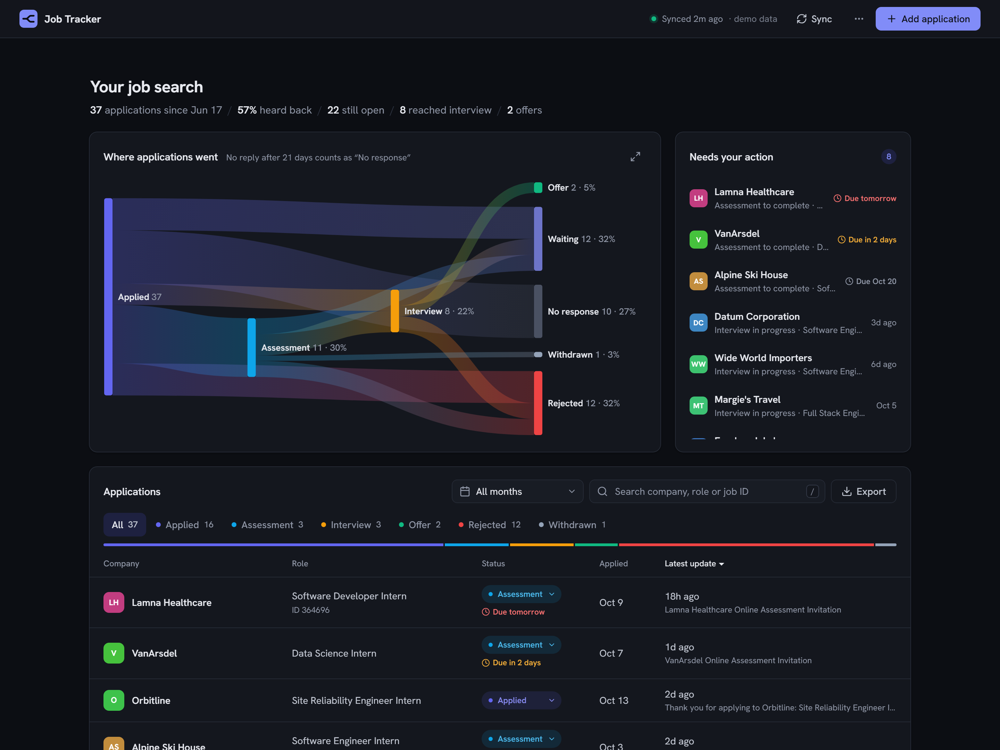
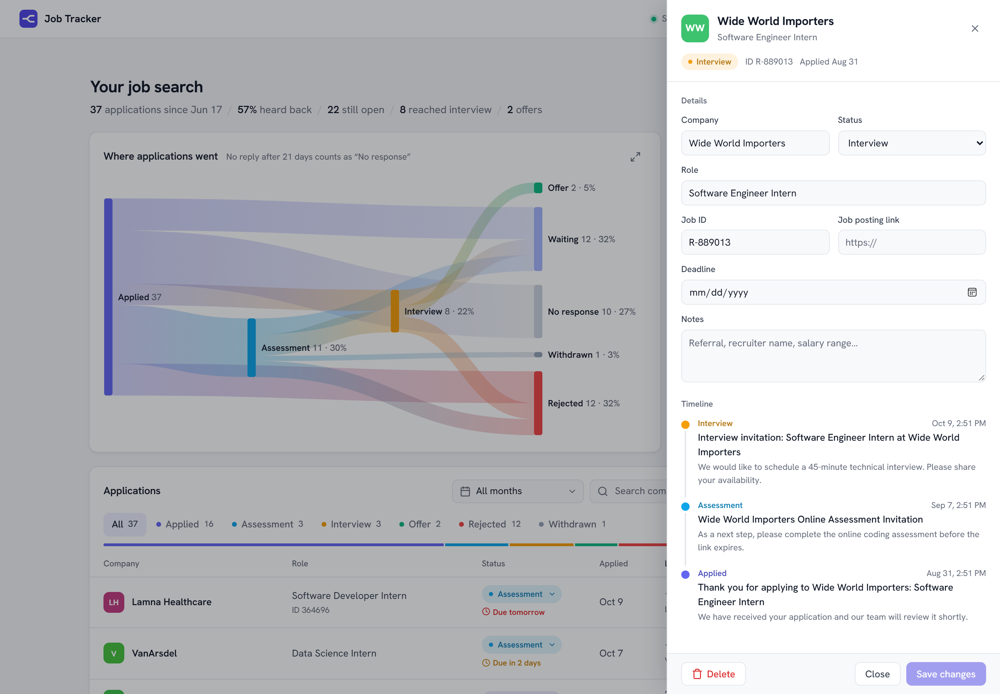
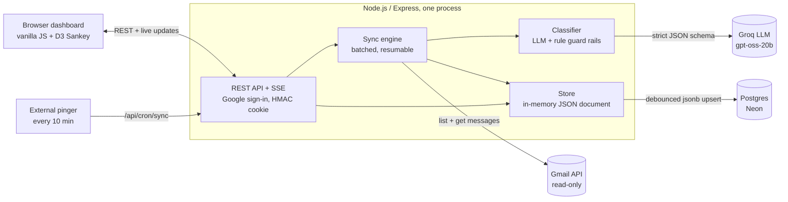

# nuj

[](https://github.com/krishjayanth/job-tracker/actions/workflows/ci.yml)


**A job-application tracker that keeps itself up to date by reading your Gmail.** It finds every confirmation,
assessment invite, interview request, offer and rejection, groups them into applications, and shows where each
one stands, what needs your attention next, and where your search as a whole is going.

<picture>
  <source media="(prefers-color-scheme: dark)" srcset="docs/dashboard-dark.png">
  
</picture>

## Why I built it

Applying to dozens of internships meant the real status of each application was spread across hundreds of
automated emails from Workday, Greenhouse, HackerRank and others. Spreadsheets went stale within a week. This
tracker replaces the spreadsheet: it reads the inbox (read-only), works out what each email means, and updates
itself every few minutes.

## Try it in 30 seconds

```bash
npm install
npm run demo
```

Then open http://localhost:5178. Demo mode loads a made-up job search (37 applications at fictional companies)
into memory, so you can click around, edit, filter and export without a Google account. Nothing is saved.

## What it does

- **Reads Gmail automatically.** It checks every few minutes using read-only access, then classifies each
  application email with an LLM that rule-based checks verify.
- **Shows where applications went.** A Sankey chart traces every application from *Applied* through
  *Assessment* and *Interview* to *Offer*, *Rejected*, *Withdrawn* or *No response*. Click a stage to filter.
- **Lists what needs your action.** Assessments to finish, interviews in progress and offers, with deadlines
  parsed from the emails ("expires in 5 days", "complete by Oct 9 at 11:59 PM"). You can set or change a
  deadline's date and time yourself; a date with no time means the end of that day.
- **Keeps your corrections.** Renames, status changes, notes and deadlines survive a full re-scan of the inbox.
- **Updates live and exports.** Changes stream to every open tab, and the table exports to Excel.
- **Acts on several at once.** Tick applications in the table (Shift-click for a range, Space on a focused
  row) to give them all one status, export just those, or delete them, with a single Undo.
- **Keyboard first.** ⌘K (Ctrl+K elsewhere) opens a command menu that finds any application by company,
  role or job ID, jumps between pages, filters by stage, and runs actions like Sync, Export or the theme switch.



## Architecture



A sync runs on a timer, from the **Sync** button, or when an external pinger calls it (which also keeps Render's
free tier awake):

1. **Narrow the inbox.** A Gmail search keeps only emails from hiring platforms or with application-related subjects,
   minus any senders you've chosen to ignore.
2. **Is it about a job at all?** Free checks run first: hiring software counts as a job, and housing, utility,
   banking, school and similar wording with nothing about a job is dropped, so a landlord's "thank you for your
   application" never becomes an application. When that's unclear and there's a Groq key, a small, fast model
   (`llama-3.1-8b-instant`) answers just that question before the full read is spent on it.
   ([`src/jobcheck.js`](src/jobcheck.js))
3. **Classify each email.** Groq first writes out its reasoning (who is hiring, what the email asks, which job), then
   returns the stage, company, role, job ID, deadline, a one-line summary and its confidence as strict JSON. AI and
   recorded video interviews (HireVue and the like) count as assessments. Hand-tuned rules then check it, and they
   handle the email alone if the LLM is unavailable.
4. **Match it to an application** by Gmail thread, then company plus job ID, then company plus role. The date the
   email was sent tells a second application at the same company apart: a new "thanks for applying" starts a new
   application if the old one was rejected or withdrawn before it, or had been silent for over 120 days; follow-ups
   (assessments, interviews, offers) always join. If several
   applications at one company still fit, Groq is shown that short list and picks one. When the model was unsure, the rules disagree, or the email could belong to several applications, it's flagged in "Needs your
   action" so you can confirm it, move it to the right application, or split it (with any of its other emails) into
   a new one. Your answers are kept through a re-scan.
5. **Derive status from the timeline.** Status is never stored directly. It's recomputed from the application's
   events, so a late "thanks for applying" email can't undo an interview and a manual correction always wins.
6. **Save and broadcast.** The change is persisted and pushed to every open browser over Server-Sent Events.

## Engineering highlights

- **LLM output treated as untrusted.** The model reads the email as a whole, while narrow regex rules act as guard
  rails: a company name or job ID is only accepted if it literally appears in the email, it can never be the
  hiring-software vendor, and the rules' rejection and offer checks override the model.
  ([`src/classify.js`](src/classify.js))
- **Graceful degradation.** Groq's free tier allows about 8K tokens a minute. Requests are kept lean (an excerpt of
  the email; `GROQ_REASONING_EFFORT` trades accuracy for tokens) and rate limits back off. When the wait is too long, that email falls back to
  the rules, so a sync never stalls. ([`src/groq.js`](src/groq.js))
- **Resumable, quota-aware sync.** Each processed message is recorded right away, so an interrupted sync picks up
  where it stopped. The sync window only advances once the backlog is cleared, and Gmail calls are paced with
  exponential backoff on 429s. ([`src/gmail.js`](src/gmail.js))
- **Re-scan without losing work.** Reclassifying the whole inbox snapshots every hand edit, rebuilds applications
  from scratch, then re-attaches the edits by matching Gmail message IDs. A backup is written first.
  ([`src/store.js`](src/store.js))
- **Monotonic status and an acyclic chart.** Status moves forward only, unless an application reaches a terminal
  stage or you correct it by hand. The Sankey path is built so it can never form a cycle.
  ([`src/stages.js`](src/stages.js))
- **Accounts without a user table.** Each person who signs in gets their own tracker document, Gmail connection
  and Groq key, keyed by Google's account ID. Every API call works on a per-user `Store` object, so one person's
  request can't reach another's data. Groq keys are checked on save and stored AES-256-GCM encrypted.
  ([`src/users.js`](src/users.js))
- **Cheap persistence.** Each tracker is one JSON document in memory. Writes are debounced into a single
  Postgres `jsonb` upsert and flushed on shutdown, so syncing 500 emails is one write, not 500. The same interface
  falls back to atomic local file writes or, in demo mode, memory only.
- **Small security surface.** One Google sign-in both identifies the user and grants read-only Gmail access, with
  the ID token verified server-side. Sessions are stateless HMAC-signed cookies compared in constant time. When
  hosted, the server refuses to start without an email allow-list and a strong secret.
  ([`src/auth.js`](src/auth.js))

## Tech stack

| Area | Choice |
|---|---|
| Server | Node.js 22+ (ES modules), Express 5 |
| Data | PostgreSQL on Neon (`jsonb`), or local JSON files |
| Integrations | Gmail API (`googleapis`), Google OAuth 2.0 / OpenID Connect, Groq (`gpt-oss-20b`) |
| Frontend | Vanilla JavaScript, D3 + d3-sankey, CSS custom properties (light and dark, following the system) |
| Live updates | Server-Sent Events |
| Export | ExcelJS |
| Testing / CI | `node:test`, GitHub Actions (Node 22 and 24, plus a demo-mode smoke test) |
| Hosting | Render (Blueprint in [`render.yaml`](render.yaml)) |

No frontend framework or build step: the browser loads plain scripts, and D3 is served straight from `node_modules`.

## Tests

```bash
npm test
```

There are 80 tests, written with the built-in `node:test` runner and no test dependencies. They cover:

- the rules classifier: stages, companies, roles, job IDs, and deadline parsing across dates, times and year rollover
- status and Sankey-path logic
- matching emails to applications, and confirming or moving an email you've checked
- merging the LLM's answer with the rules (AI/HireVue interviews as assessments, review flags, deadlines)
- the job check and the sorting steps, with a stand-in Groq client: non-job "applications" never reach the model
- a labeled set of 24 emails, which the rules must sort with no misses
- ignoring senders, problem reports, and counting fixes to sorting
- deadline tracking
- re-scan edit preservation
- session cookies, including tampered, unauthorized and pre-accounts ones
- accounts: separate data per person, moving single-user data to the owner, encrypted Groq keys, account deletion

CI runs them on every push, then boots the app in demo mode and checks the API.

### Measuring sorting

```bash
npm run eval            # the built-in rules
npm run eval -- --groq  # Groq too (needs GROQ_API_KEY)
```

Scores [`test/fixtures/emails.json`](test/fixtures/emails.json) (job vs. not a job, stage, company) and lists every
miss. When sorting gets an email wrong, add a version of it there so the fix stays fixed. The owner's Reports page
also shows how often people fix sorting across all accounts.

## Project layout

| Path | What's there |
|---|---|
| [`server.js`](server.js) | Express app: routes, auth gate, SSE, sync scheduling, graceful shutdown |
| [`src/gmail.js`](src/gmail.js) | OAuth client; each person's Gmail sync and re-scan engine |
| [`src/classify.js`](src/classify.js) | The sorting steps: job check, Groq or rules, merging the two |
| [`src/jobcheck.js`](src/jobcheck.js) | Is an email about a job? Hiring-software senders, job and non-job wording |
| [`src/groq.js`](src/groq.js) | Groq client: the job check, the full read, and picking between applications |
| [`src/reports.js`](src/reports.js) | Problem reports people send, for the owner |
| [`src/rules.js`](src/rules.js) | Rule-based classifier: stages, companies, roles, job IDs, deadlines |
| [`src/stages.js`](src/stages.js) | Pipeline stages, status and chart-path logic |
| [`src/store.js`](src/store.js) | Persistence, application matching, re-scan snapshots |
| [`src/auth.js`](src/auth.js) | Sign-in sessions and the login middleware |
| [`src/users.js`](src/users.js) | Accounts: each person's tracker, mailbox and Groq key; account deletion |
| [`src/secrets.js`](src/secrets.js) | Encryption for stored Groq keys |
| [`src/export.js`](src/export.js) | Excel export |
| [`src/demo.js`](src/demo.js) | Sample data for demo mode |
| [`public/`](public/) | Dashboard (HTML, CSS, JS) |
| [`test/`](test/) | Test suites, and the labeled emails in `test/fixtures/` |
| [`scripts/eval.js`](scripts/eval.js) | Scores sorting on the labeled emails |

## Deploy your own

It runs on free tiers (Render, Neon, Groq, Google Cloud). See **[docs/DEPLOY.md](docs/DEPLOY.md)** for the
step-by-step setup and every configuration option.
